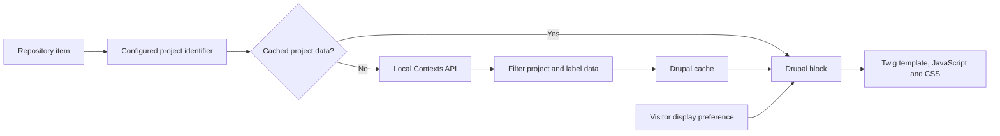

# TeamX Islandora

**A Drupal integration that brings Local Contexts Traditional Knowledge labels into digital collection pages.**

## About

TeamX Islandora is a collaborative software engineering project that connects an Islandora digital repository with the Local Contexts API. It lets repository administrators associate collection items with a Local Contexts project and display its Traditional Knowledge (TK) labels alongside the item. The custom Drupal module handles API requests, filters the returned data, caches project information, and renders labels through a configurable block. The project combines backend integration, Drupal configuration, and interface development to make contextual information easier to find within a digital collection.

## Features

- **Item-to-project linking:** reads a Local Contexts project identifier from a configurable field on a repository item.
- **API integration:** retrieves project information and TK labels using a configurable endpoint and API key.
- **Cached project data:** reuses successfully processed responses through a dedicated Drupal cache backend.
- **Configurable display:** renders project details and labels in a Drupal block, with a choice of label names alone or names and text.
- **Administrative settings:** provides a configuration form for the endpoint, API key, and identifier field.
- **Failure handling:** logs missing configuration, missing fields, and unsuccessful API responses.

## How it works

The integration reads the current Drupal node, looks up its project identifier, and checks the cache before making an external request. The block then passes the processed data to the template for display. Display preferences are stored in the visitor's session.

## Technology

| Area | Tools |
| --- | --- |
| Application platform | Drupal 10 and Islandora |
| Backend | PHP, Guzzle HTTP client, Drupal services and cache API |
| Interface | Twig, JavaScript, CSS, Drupal Form and Block APIs |
| Development infrastructure | Docker Compose and Islandora DevOps scaffolding |
| Test structure | PHPUnit unit, kernel, and functional tests |

## Explore the implementation

The custom module lives at [`drupal/rootfs/var/www/drupal/web/modules/custom/local_contexts_integration`](drupal/rootfs/var/www/drupal/web/modules/custom/local_contexts_integration).

| Component | Responsibility |
| --- | --- |
| [`LocalContextsController.php`](drupal/rootfs/var/www/drupal/web/modules/custom/local_contexts_integration/src/Controller/LocalContextsController.php) | Project lookup, API requests, response filtering, and caching |
| [`LocalContextsBlock.php`](drupal/rootfs/var/www/drupal/web/modules/custom/local_contexts_integration/src/Plugin/Block/LocalContextsBlock.php) | Builds the label display for repository pages |
| [`LocalContextsSettingsForm.php`](drupal/rootfs/var/www/drupal/web/modules/custom/local_contexts_integration/src/Form/LocalContextsSettingsForm.php) | Administrative configuration |
| [`TkLabelDisplayForm.php`](drupal/rootfs/var/www/drupal/web/modules/custom/local_contexts_integration/src/Form/TkLabelDisplayForm.php) | Visitor display preferences |
| [`templates/`](drupal/rootfs/var/www/drupal/web/modules/custom/local_contexts_integration/templates) | Twig rendering |
| [`tests/`](drupal/rootfs/var/www/drupal/web/modules/custom/local_contexts_integration/tests) | Unit, kernel, and functional test code |

## Setup and configuration

This repository includes a complete Islandora development scaffold. Start with the [environment requirements and Docker Compose guide](README.template.md) and the preserved [upstream setup instructions](docs/upstream-setup.md).

Once the Drupal environment is running:

1. Enable the **Local Contexts Integration** module and its Drupal dependencies.
2. Open `/admin/config/Islandora/localcontexts` as an administrator.
3. Configure the API endpoint, API key, and field containing the Local Contexts project identifier. The checked-in defaults use the sandbox endpoint and `field_local_contexts`.
4. Populate that identifier field on a repository item.
5. Place the **Local Contexts Block** in the appropriate page region and view the item.

Use a development API key and an environment you control when evaluating the integration.

## Testing and project status

The custom module includes unit, kernel, and functional test directories. Running them requires the matching Drupal/Islandora environment, Composer dependencies, and PHPUnit configuration. The documentation update does not establish that the full integration suite currently passes; verify it in a configured environment before deployment.

This repository presents the team's implementation and its development infrastructure. Future improvements include a single documented test command, automated integration checks, and a reproducible demonstration with sample collection items.

## Acknowledgements and license

The infrastructure builds on Islandora DevOps' [isle-site-template](https://github.com/Islandora-Devops/isle-site-template) and [islandora-starter-site](https://github.com/Islandora-Devops/islandora-starter-site). The integration uses data from [Local Contexts](https://localcontexts.org/). Upstream infrastructure and collaborators' work retain their respective attribution.

See [LICENSE](LICENSE) for the repository's license.
